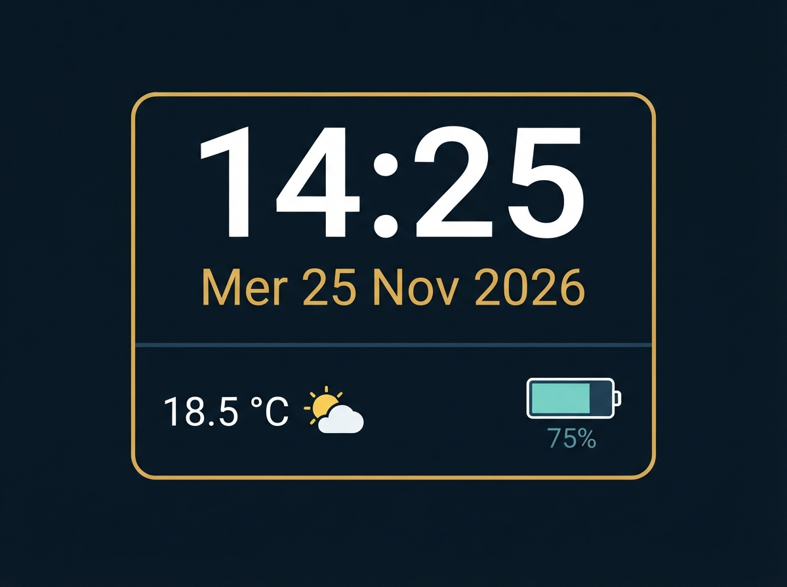

# 📻 Raspiaudio Radio — ESPHome Firmware (Music Assistant, Voice Assistant & Standalone Web Radio)

[](https://afer92.github.io/MuseRadio/)
[](https://github.com/afer92/MuseRadio/blob/main/LICENSE)
[](https://esphome.io)
[](https://github.com/afer92/MuseRadio/actions/workflows/deploy-pages.yml)
[](https://afer92.github.io/MuseRadio/)


🌐 **[English](#-english)** | **[Français](#-français)**
---

## 🇬🇧 English

> **Note:** This project is derived from [RASPIAUDIO/esphomeRadio](https://github.com/RASPIAUDIO/esphomeRadio).

Complete, optimized **ESPHome** configuration for the **Raspiaudio Radio (ESP32-S3)** board, seamlessly integrating:
* **Music Assistant (via Sendspin)**: 48 kHz FLAC multiroom playback with metadata display and group volume control.
* **Home Assistant Voice Assistant & microWakeWord**: Local wake word detection (*Okay Nabu*, *Hey Jarvis*, *Hey Mycroft*, *Stop*) with smart switching of the shared I2S audio bus.
* **Standalone Local Web Radio (MP3)**: Direct streaming of Icecast/HTTP radio stations without relying on Home Assistant or Music Assistant.
* **Event-Driven GUI & Smart Clock Screensaver (ST7789V 320×240)**: High-performance display (`update_interval: never`) featuring Home Assistant weather (temperature + vector icon), battery gauge, Wi-Fi signal strength, visual action feedback, and an automatic clock screensaver with day/night brightness control.

---

## ✨ Key Features

### 1. Dual Radio Playback Modes
* **Music Assistant Mode (Buttons 1, 2, and 3)**:
  * **Short press (< 1 s)**: Plays the stored station on the configured Music Assistant player (`ma_player_entity_id`).
  * **Long press (≥ 1.8 s)**: Fetches the currently playing station URI via `music_assistant.get_queue` and saves it to the button's flash memory.
* **Standalone Direct Web Radio Mode (Button 4 + Station Encoder)**:
  * **Left rotary encoder (`GPIO6` / `GPIO7`)**: Scrolls through the local station dropdown list (`local_radio_select`) with instant on-screen preview and automatic debounced switching (`600 ms`) if playback is already active.
  * **Short press on Button 4**: Starts or stops the selected direct MP3 stream (9 customizable stations in `stations/stations.yaml`, or your custom URL on slot **`10 - Station 4 (URL)`**), automatically pausing Music Assistant if needed.

### 2. Smart Voice Assistant (microWakeWord + Assist)
* **Local Detection**: Supports `okay_nabu`, `hey_jarvis`, `hey_mycroft`, and `stop` models with on-the-fly sensitivity adjustment from Home Assistant (*Slightly*, *Moderately*, *Very sensitive*).
* **Temporary Music Interruption (`temporary_assist`)**: Pressing the **Assist button (`GPIO45`)** or the IR remote pauses the Sendspin group, releases the shared I2S bus, listens to your voice command, and automatically resumes music playback afterward.

### 3. Clock Screensaver & Adaptive Brightness
* **Automatic Standby (`clockP`)**: Activates after inactivity, triggered by timers, IR `Bin` key, Web Radio, or Music Assistant, showing time, date, weather, battery, and status badges (**`MIC OFF`**, **`USB`**).
* **Astronomical Day/Night Backlight (`sun` + `update_clock_brightness`)**: Adjusts backlight brightness automatically using local sunrise and sunset coordinates (75% daytime, 25% night).

### 4. Advanced Hardware Management
* **ES8388 Audio Codec**: Features automatic headphone jack detection (`GPIO10`) with I2C switching, an on-screen **`CASQUE`** indicator, and fine gain adjustment for low volumes (< 10%).
* **Power & Battery**: Uses voltage measurement (`GPIO13`) mapped via a polynomial curve for percentage, alongside USB charging detection (`GPIO21`).
* **Infrared Remote (`GPIO47`, NEC protocol)**: Controls volume, mute, voice assistant, Music Assistant presets (1–3), Web Radio stations, and playback-stopping standby via the `Bin` key.

---

## 🎛️ Physical Controls

| Control | Pin(s) | Short Press | Long Press / Rotation |
| :--- | :--- | :--- | :--- |
| **Volume Encoder** | `GPIO42` / `GPIO3` | — | Adjusts volume (MA group or local volume) |
| **Volume Encoder Click** | `GPIO48` | Mute / Unmute | — |
| **Function Encoder** | `GPIO7` / `GPIO6` | — | Selects a station from the Web Radio list |
| **Function Encoder Click** | `GPIO45` | Starts / stops **Assist** | Toggles **Mute Microphone** (≥ 1 s) |
| **Buttons 1–3** | `GPIO1` (ADC) | Plays **MA Presets 1–3** | Saves current station to Presets 1–3 |
| **Button 4 (Confirm)** | `GPIO1` (ADC) | Starts / Stops **Local Web Radio** | — |

---

## 🛠️ Installation & Prerequisites

### ⚡ Quick Install via Browser (Recommended)

You can flash the pre-compiled firmware directly onto your **Raspiaudio Radio (ESP32-S3)** via USB without installing ESPHome:

👉 **https://afer92.github.io/MuseRadio/** *(Requires Google Chrome or Microsoft Edge on desktop)*

Once flashed, connect to the **`Raspiaudio-radio-full`** Wi-Fi access point (password: `12345678`) to configure your Wi-Fi network.

### 1. Software Prerequisites
* **ESPHome** (`esp-idf` framework) via Home Assistant or CLI.
* **Home Assistant** with **Music Assistant** integration (Sendspin) and a weather entity (default: `weather.forecast_maison`, configurable in `.variables`).
* **Authorization**: Enable **"Allow the device to perform Home Assistant actions"** in Home Assistant under **Settings → Devices & Services → ESPHome → Your Radio → Configure / Options**.

### 2. Required Directory Structure

Organize your files in `/config/esphome/` to include the main config (`Raspiaudio.yaml`), `secrets.yaml`, the `common/`, `docs/`, `stations/`, and `images/` subdirectories:

```text
/config/esphome/
├── Raspiaudio.yaml
├── secrets.yaml
├── common/base_text_sensor.yaml
├── docs/screen.jpg
├── examples/raspiaudio-minimal.yaml
├── stations/stations.yaml
└── images/ (Raspiaudio.png, WFWW.png, W.png, LISTEN.png, ANSWER.png, mute_mic.png, mute_speaker.png)
```


### 3. Configuring `secrets.yaml`
Add your Wi-Fi credentials and geographic coordinates (used for sunrise/sunset screen brightness) in `secrets.yaml`:

```yaml
wifi_ssid: "Your_Primary_SSID"
wifi_ssid_1: "Your_Secondary_SSID"
wifi_password: "Your_WiFi_Password"
latitude: 48.8966
longitude: 2.2567
```
---

### 4. Minimal Remote Package Installation (Recommended for ESPHome Dashboard)

Instead of manually copying all YAML files, you can import this repository directly as a remote ESPHome package (see [`examples/raspiaudio-minimal.yaml`](examples/raspiaudio-minimal.yaml)):

1. Copy the **`images/`** folder from this repository into your local `/config/esphome/images/` directory (ESPHome does not automatically download binary PNG assets from remote GitHub packages).
2. Create a new device in your ESPHome Dashboard with the following minimal configuration:

```yaml
substitutions:
  deviceid: "aaa000" # your choice
  name: raspiaudio-radio-${deviceid}
  friendly_name: Raspiaudio Radio ${deviceid}

.variables:
  - &weather_entity "weather.forecast_maison" # your weather entity

packages:
  museradio:
    url: https://github.com/afer92/MuseRadio
    ref: main
    files:
      - Raspiaudio.yaml
    refresh: 1d

wifi:
  networks:
    - ssid: !secret wifi_ssid
      password: !secret wifi_password
    - ssid: !secret wifi_ssid_1
      password: !secret wifi_password

sun:
  latitude: !secret latitude
  longitude: !secret longitude

sensor:
  - id: !extend ha_weather_temperature
    entity_id: *weather_entity

text_sensor:
  - id: !extend ha_weather_condition
    entity_id: *weather_entity
```

## ⚙️ Home Assistant Configuration

Once the device is flashed and added under **Settings → Devices & Services → ESPHome**, the following configuration entities are available:
* **Web Radio Station** (`select`): Choose the station played directly by Button 4 (or scrolled via the left rotary encoder).
* **Wake word sensitivity** (`select`): Adjust the local wake word detection threshold (*Slightly*, *Moderately*, or *Very sensitive*).
* **Station button 1 to 3** (`text`): View or manually edit the Music Assistant URIs (`library://radio/...` or `http://...`) assigned to Buttons 1–3.
* **Station button 4** (`text`): Enter a custom MP3 stream URL (`http://...` or `https://...`) accessible directly via the station encoder under option **`10 - Station 4 (URL)`**.
* **set_ma_player_entity_id** (`text`): Override the Home Assistant entity ID of the Music Assistant player (e.g., `media_player.raspiaudio_radio`) if automatic detection is not desired.
* **Mute Microphone** (`switch`): Mutes or unmutes the local microphone (also controllable via a long press on `GPIO45`), showing a **`MIC OFF`** badge on standby and clock screens.
* **Clock Brightness Day** (`number`): Adjusts the daytime backlight percentage for the clock screensaver (default: `75%`, range: `10–100%`).
* **Clock Brightness Night** (`number`): Adjusts the nighttime backlight percentage for the clock screensaver (default: `25%`, range: `0–100%`).

---

## 🏗️ Hardware Architecture (ESP32-S3 Pinout)

* **Microcontroller**: `esp32-s3-devkitc-1` (8 MB Flash, 80 MHz Octal PSRAM, 240 MHz CPU)
* **I2C Bus (ES8388 Codec @ `0x10`)**: `SDA = GPIO18`, `SCL = GPIO11`
* **I2S Audio Bus**: `MCLK = GPIO0`, `BCLK = GPIO5`, `LRCLK = GPIO16`, `DOUT = GPIO17`, `DIN = GPIO4`, `DAC_MUTE = GPIO46`
* **SPI Display (`mipi_spi` ST7789V 320×240)**: `CLK = GPIO12`, `MOSI = GPIO8`, `CS = GPIO40`, `DC = GPIO39`, `RST = GPIO9`, `Backlight = GPIO41`
* **Inputs & Power**: `Buttons ADC = GPIO1`, `Volume Encoder = GPIO42/GPIO3 (Click: GPIO48)`, `Function Encoder = GPIO7/GPIO6 (Click: GPIO45)`, `Jack Detect = GPIO10`, `IR Receiver = GPIO47`, `Battery ADC = GPIO13`, `USB Power = GPIO21`
* **Infrared Remote (`GPIO47`, NEC protocol)**: Volume +/-, Mute/Unmute, Voice Assistant trigger, Web Radio station next/previous, and local Web Radio start/stop.

---

## 🩺 Troubleshooting (FAQ)

### 1. Compilation Error: `'logoP' was not declared in this scope`
* **Cause**: The C++ call `id(myDisplay).show_page(logoP)` in `on_boot:` is evaluated before the `display:` page identifiers are declared, or an indentation mistake prevents `display:` from being parsed.
* **Solution**: Use the native YAML action `- display.page.show: logoP` followed by `- component.update: myDisplay` in `on_boot:`, and ensure there is only one top-level `display:` block and one top-level `select:` block in your file.

### 2. Local Web Radio (Button 4) fails to start or audio stays locked
* **Cause**: The `music_speaker` audio pipeline is still locked by **Music Assistant (Sendspin)**, or `local_radio_player` has not closed its previous HTTP stream.
* **Solution**:
  * Make sure `toggle_local_radio` stops `music_source_player` and waits up to `4s` before launching `local_radio_player`.
  * If an Icecast stream freezes after a network drop, press **Button 4** once to force `media_player.stop` (`STOP RADIO`), wait 1 second, then press it again to reconnect.

### 3. Audio volume is too loud at boot or when starting Web Radio
* **Cause**: By default, an ESPHome `media_player` component initializes its software volume at `1.0` (100%).
* **Solution**:
  * Ensure `volume_initial: 0.2` is set on `local_radio_player`.
  * In the `logo` script, keep the temporary volume cap `std::min(id(Vol), 0.20f)` before playing `little_sound`.

### 4. Wake word (*Okay Nabu*) does not trigger while music is playing
* **Expected Behavior**: To prevent the speaker from self-triggering the microphone and to preserve ESP32-S3 CPU resources during 48 kHz FLAC decoding, `micro_wake_word` is intentionally paused while `music_active` is true.
* **Using Assist during music**: Press the **Assist button (`GPIO45`)** or the **Back/Return** button on your IR remote. The `temporary_assist` script will pause playback, release the I2S bus, listen to your command, and automatically resume music afterward.

### 5. Long-pressing Buttons 1–3 displays `"NO RADIO"` or `"PLAY FAILED"`
* **Cause**: The Music Assistant entity (`ma_player_entity_id`) is not yet stored on the ESP32, or no active queue is detected in Home Assistant.
* **Solution**:
  1. Start a radio station once from the Home Assistant UI on your Raspiaudio player.
  2. Hold **Button 1, 2, or 3** for **2 seconds** until `"MEMO X OK"` appears on screen: the device will automatically save both the player entity ID and the stream URI.
  3. Alternatively, manually enter the entity ID (e.g., `media_player.raspiaudio_radio`) into the **set_ma_player_entity_id** text field on the device page in Home Assistant.

### 6. Station selector encoder skips 2 stations per click
* **Cause**: The `resolution` parameter on `function_encoder` is set to `2` instead of `1`.
* **Solution**: Set `resolution: 1` under the `rotary_encoder` configuration for `function_encoder` (`GPIO7` / `GPIO6`).

### 7. Header temperature or weather icon displays `--°C`
* **Cause**: The weather entity defined in `.variables` (`&weather_entity "weather.forecast_maison"`) does not match an existing entity in your Home Assistant instance, or the ESP32 is not yet connected to the Home Assistant API.
* **Solution**: Replace `"weather.forecast_maison"` at the top of `Raspiaudio.yaml` with your actual Home Assistant weather entity ID (e.g., `"weather.home"` or `"weather.openweathermap"`).

### 8. Screen stays on clock or stuck on `"Waiting WiFi..."`
* **Clock screen after 1 minute**: The clock screen automatically turns on after `60 s` of inactivity (`lightTO`) with automatic sunrise/sunset brightness (75% day / 25% night). Turn either rotary encoder or press any button to wake the screen.
* **Stuck on `"Waiting WiFi..."`**: Check your credentials in `secrets.yaml`. If no configured network is reachable, the device enables its fallback access point **`Raspiaudio-radio-full`** (password: `12345678`) so you can reconfigure Wi-Fi via the captive portal.

---



## 📄 License


This project is licensed under the **GNU General Public License v3.0 (GPL-3.0)** — see the [LICENSE](LICENSE) file for details.
---

## 🇫🇷 Français

# 📻 Raspiaudio Radio — Firmware ESPHome (Music Assistant, Voice Assistant & Web Radio autonome)


> **Note:** Ce projet est dérivé de [RASPIAUDIO/esphomeRadio](https://github.com/RASPIAUDIO/esphomeRadio).
> 
Configuration **ESPHome** complète et optimisée pour la carte **Raspiaudio Radio (ESP32-S3)** intégrant simultanément :
* **Music Assistant (via Sendspin)** : lecture multiroom FLAC 48 kHz avec affichage des métadonnées et contrôle du volume de groupe.
* **Home Assistant Voice Assistant & microWakeWord** : détection locale des mots de réveil (*Okay Nabu*, *Hey Jarvis*, *Hey Mycroft*, *Stop*) avec bascule intelligente du bus I2S partagé.
* **Radio Web locale autonome (MP3)** : écoute directe de flux radio Icecast/HTTP sans dépendre de Home Assistant ni de Music Assistant.
* **Interface graphique événementielle (ST7789V 320×240)** : affichage haute performance (`update_interval: never`) avec météo Home Assistant (température + icône vectorielle), jauge batterie, signal Wi-Fi, retour visuel des actions et écran de veille horloge.

---

## ✨ Fonctionnalités principales

### 1. Double mode d'écoute Radio
* **Mode Music Assistant (Boutons 1, 2 et 3)** :
  * **Appui court (< 1 s)** : lance la station mémorisée sur le lecteur Music Assistant configuré (`ma_player_entity_id`).
  * **Appui long (≥ 1,8 s)** : récupère l'URI de la station en cours via `music_assistant.get_queue` et l'enregistre dans la mémoire flash du bouton.
* **Mode Web Radio directe autonome (Bouton 4 + Encodeur Station)** :
  * **Encodeur rotatif gauche (`GPIO6` / `GPIO7`)** : permet de parcourir la liste déroulante des stations locales (`local_radio_select`) avec aperçu immédiat à l'écran et bascule automatique temporisée (`600 ms`) si la lecture est déjà active.
  * **Appui court sur le Bouton 4** : démarre ou arrête le flux MP3 direct sélectionné (9 stations personnalisables dans `stations/stations.yaml`, ou votre URL personnalisée sur l'emplacement **`10 - Station 4 (URL)`**), en coupant automatiquement Music Assistant si nécessaire.

### 2. Assistant Vocal intelligent (microWakeWord + Assist)
* **Détection locale** : prise en charge des modèles `okay_nabu`, `hey_jarvis`, `hey_mycroft` et `stop` avec réglage de sensibilité à la volée depuis Home Assistant (*Slightly*, *Moderately*, *Very sensitive*).
* **Interruption temporaire de la musique (`temporary_assist`)** : un appui sur le bouton **Assist (`GPIO45`)** ou la télécommande IR met en pause le groupe Sendspin, libère le bus I2S partagé, écoute la commande vocale, puis relance automatiquement la musique.

### 3. Gestion matérielle avancée & Écran de veille
* **Codec Audio ES8388** :
  * Détection automatique de prise casque (`GPIO10`) avec commutation matérielle des registres I2C entre haut-parleur interne et sortie ligne/casque.
  * Courbe de gain fine sur les registres `0x2E`–`0x31` pour un réglage précis à très bas volume (`< 10 %`).
* **Écran Horloge intelligent (`clockP`)** : s'active automatiquement après `60 s` d'inactivité en veille, affiche l'heure, la date, la météo et le niveau de batterie, et ajuste automatiquement la luminosité du rétroéclairage selon les heures réelles de lever et de coucher du soleil (75 % le jour, 25 % la nuit).
* **Alimentation & Batterie** : mesure de tension (`GPIO13`) convertie en pourcentage via une courbe polynomiale à 22 points et détection de charge USB (`GPIO21`).
* **Télécommande Infrarouge (`GPIO47`, protocole NEC)** : volume +/-, Mute/Unmute, déclenchement de l'assistant vocal, changement de station Web Radio (suivante/précédente) et démarrage/arrêt de la Web Radio locale.

---

## 🎛️ Commandes physiques

| Contrôle | Broche(s) | Action courte | Action longue / Rotation |
| :--- | :--- | :--- | :--- |
| **Encodeur Volume** | `GPIO42` / `GPIO3` | — | Ajuste le volume (groupe MA ou volume local) |
| **Clic Encodeur Volume** | `GPIO48` | Mute / Unmute | — |
| **Encodeur Fonction** | `GPIO7` / `GPIO6` | — | Sélectionne la station dans la liste Web Radio |
| **Clic Encodeur Fonction** | `GPIO45` | Lance / interrompt **Assist** | Active / désactive **Mute Microphone** (≥ 1 s) |
| **Boutons 1 à 3** | `GPIO1` (ADC) | Joue les **Presets MA 1 à 3** | Mémorise la station MA en cours sur **Presets 1 à 3** |
| **Bouton 4 (Confirm)** | `GPIO1` (ADC) | Démarre / Arrête la **Web Radio locale** | — |

---

## 🛠️ Installation et prérequis

### ⚡ Installation rapide via le navigateur (Recommandée)

👉 **https://afer92.github.io/MuseRadio** *(Nécessite Google Chrome ou Microsoft Edge sur ordinateur)*

Une fois le flashage terminé, connectez-vous au point d'accès Wi-Fi **`Raspiaudio-radio-full`** (mot de passe : `12345678`) pour configurer votre réseau Wi-Fi.

### 1. Prérequis logiciels

* **ESPHome** (`esp-idf`) via Home Assistant ou CLI.
* **Home Assistant** incluant l'intégration **Music Assistant** (Sendspin) et une entité météo (`weather.forecast_maison` par défaut, paramétrable dans `.variables`).
* **Autorisation indispensable** : dans Home Assistant, allez dans **Paramètres → Appareils et services → ESPHome → Votre Radio → Configurer / Options** et cochez **« Autoriser l'appareil à exécuter des actions Home Assistant »** (*Allow the device to perform Home Assistant actions*).

### 2. Arborescence des fichiers requise

Placez les fichiers dans `/config/esphome/` en conservant cette structure :

```text
/config/esphome/
├── Raspiaudio.yaml
├── secrets.yaml
├── common/base_text_sensor.yaml
├── docs/screen.jpg
├── examples/raspiaudio-minimal.yaml
├── stations/stations.yaml
└── images/ (Raspiaudio.png, WFWW.png, W.png, LISTEN.png, ANSWER.png, mute_mic.png, mute_speaker.png)
```

### 3. Configuration de `secrets.yaml`

Configurez vos identifiants Wi-Fi (principal et de secours) dans `secrets.yaml` :

```yaml
wifi_ssid: "Votre_SSID_Principal"
wifi_ssid_1: "Votre_SSID_Secondaire"
wifi_password: "Votre_Mot_De_Passe_WiFi"
latitude: 48.8966
longitude: 2.2567
```

### 4. Installation via Package distant minimaliste (Recommandée sous ESPHome Dashboard)

Plutôt que de copier manuellement tous les fichiers YAML, vous pouvez importer ce dépôt directement comme package distant ESPHome (voir [`examples/raspiaudio-minimal.yaml`](examples/raspiaudio-minimal.yaml)) :

1. Copiez uniquement le dossier **`images/`** de ce dépôt dans votre répertoire local `/config/esphome/images/` (ESPHome ne télécharge pas automatiquement les fichiers binaires `.png` depuis un package GitHub distant).
2. Créez un nouvel appareil dans votre tableau de bord ESPHome avec cette configuration minimale :

```yaml
substitutions:
  deviceid: "aaa000" # votre choix
  name: raspiaudio-radio-${deviceid}
  friendly_name: Raspiaudio Radio ${deviceid}

.variables:
  - &weather_entity "weather.forecast_maison" # votre identité weather

packages:
  museradio:
    url: https://github.com/afer92/MuseRadio
    ref: main
    files:
      - Raspiaudio.yaml
    refresh: 1d

wifi:
  networks:
    - ssid: !secret wifi_ssid
      password: !secret wifi_password
    - ssid: !secret wifi_ssid_1
      password: !secret wifi_password

sun:
  latitude: !secret latitude
  longitude: !secret longitude

sensor:
  - id: !extend ha_weather_temperature
    entity_id: *weather_entity

text_sensor:
  - id: !extend ha_weather_condition
    entity_id: *weather_entity
```

---

## ⚙️ Paramétrage dans Home Assistant

Une fois l'appareil flashé et ajouté dans **Paramètres → Appareils et services → ESPHome**, vous disposez des contrôles suivants :
* **Web Radio Station** (`select`) : choisissez la station jouée en direct par le bouton 4 (ou parcourue via l'encodeur gauche).
* **Wake word sensitivity** (`select`) : ajustez la sensibilité du micro de réveil (*Slightly*, *Moderately* ou *Very sensitive*).
* **Station button 1 à 3** (`text`) : visualisez ou modifiez manuellement les URI (`library://radio/...` ou `http://...`) des boutons Music Assistant.
* **Station button 4** (`text`) : saisissez une URL MP3 personnalisée (`http://...` ou `https://...`) accessible directement depuis la molette sous l'option **`10 - Station 4 (URL)`**.
* **set_ma_player_entity_id** (`text`) : forcez l'identifiant d'entité Home Assistant du lecteur Music Assistant (ex. `media_player.raspiaudio_radio`) si la détection automatique n'est pas souhaitée.
* **Mute Microphone** (`switch`) : Contrôle du micro (pilotable aussi via appui long sur `GPIO45`) avec indicateur visuel et badge **`MIC OFF`**.
* **Clock Brightness Day** (`number`) : règle le pourcentage de luminosité de jour de l'écran horloge (par défaut : `75 %`, plage : `10–100 %`).
* **Clock Brightness Night** (`number`) : règle le pourcentage de luminosité de nuit de l'écran horloge (par défaut : `25 %`, plage : `0–100 %`).

---

## 🏗️ Architecture technique (Brochage ESP32-S3)

* **Microcontrôleur** : `esp32-s3-devkitc-1` (Flash 8 Mo, PSRAM Octal 80 MHz, CPU 240 MHz)
* **Bus I2C (Codec ES8388 @ `0x10`)** : `SDA = GPIO18`, `SCL = GPIO11`
* **Bus I2S Audio** : `MCLK = GPIO0`, `BCLK = GPIO5`, `LRCLK = GPIO16`, `DOUT = GPIO17`, `DIN = GPIO4`, `DAC_MUTE = GPIO46`
* **Écran SPI (`mipi_spi` ST7789V 320×240)** : `CLK = GPIO12`, `MOSI = GPIO8`, `CS = GPIO40`, `DC = GPIO39`, `RST = GPIO9`, `Backlight = GPIO41`
* **Entrées & Alimentation** : Boutons `ADC = GPIO1`, Encodeur `Volume = GPIO42/GPIO3 (Clic : GPIO48)`, Encodeur `Fonction = GPIO7/GPIO6 (Clic : GPIO45)`, Détection `Casque = GPIO10`, Récepteur `IR = GPIO47`, Batterie `ADC = GPIO13`, Alimentation `USB = GPIO21`

---

## 🩺 Dépannage (FAQ)

### 1. Erreur de compilation : `'logoP' was not declared in this scope`
* **Cause** : L'appel C++ `id(myDisplay).show_page(logoP)` dans `on_boot:` est évalué avant que les identifiants de pages de `display:` ne soient déclarés, ou une erreur d'indentation empêche la génération de la section `display:`.
* **Solution** : Utilisez l'action native YAML `- display.page.show: logoP` suivie de `- component.update: myDisplay` dans `on_boot:`, et vérifiez qu'il n'existe qu'un seul bloc `display:` et un seul bloc `select:` de premier niveau dans votre fichier.

### 2. La Web Radio locale (Bouton 4) ne démarre pas ou le son reste bloqué
* **Cause** : Le bus audio `music_speaker` est encore verrouillé par **Music Assistant (Sendspin)** ou le lecteur local `local_radio_player` n'a pas fermé son flux HTTP précédent.
* **Solution** :
  * Vérifiez que `toggle_local_radio` arrête bien `music_source_player` et attend `4s` avant de lancer `local_radio_player`.
  * Si un flux Icecast reste figé après une coupure réseau, appuyez une fois sur le **Bouton 4** pour forcer `media_player.stop` (`STOP RADIO`), attendez 1 seconde, puis appuyez de nouveau pour relancer la connexion.

### 3. Le volume sonore est trop fort au démarrage ou au lancement de la Web Radio
* **Cause** : Par défaut, un composant `media_player` sous ESPHome initialise son volume logiciel à `1.0` (100 %).
* **Solution** :
  * Assurez-vous que `volume_initial: 0.2` est bien défini sur `local_radio_player`.
  * Dans le script `logo`, conservez la limitation temporaire `std::min(id(Vol), 0.20f)` avant la lecture de `little_sound`.

### 4. L'assistant vocal ne se déclenche pas à la voix (*Okay Nabu*) pendant la musique
* **Comportement normal** : Pour éviter que le haut-parleur n'auto-déclenche le micro et pour préserver les ressources CPU de l'ESP32-S3 pendant le décodage FLAC 48 kHz, `micro_wake_word` est volontairement mis en pause lorsque `music_active` est vrai.
* **Utilisation pendant la musique** : Appuyez sur le **bouton Assist (`GPIO45`)** ou sur la touche **Retour** de la télécommande IR. Le script `temporary_assist` mettra la musique en pause, libérera le bus I2S, écoutera votre demande puis relancera automatiquement la lecture.

### 5. L'appui long sur les boutons 1 à 3 affiche `"NO RADIO"` ou `"PLAY FAILED"`
* **Cause** : L'entité Music Assistant (`ma_player_entity_id`) n'est pas encore connue de l'ESP32 ou aucune file de lecture active n'est détectée dans Home Assistant.
* **Solution** :
  1. Lancez une première fois une radio depuis l'interface Home Assistant sur votre lecteur Raspiaudio.
  2. Maintenez le **Bouton 1, 2 ou 3** appuyé pendant **2 secondes** jusqu'à l'affichage de `"MEMO X OK"` : l'appareil enregistrera automatiquement l'identifiant du lecteur et l'URI du flux.
  3. Vous pouvez aussi saisir manuellement l'entité (ex. `media_player.raspiaudio_radio`) dans le champ **set_ma_player_entity_id** de l'appareil sous Home Assistant.

### 6. L'encodeur de sélection de stations saute 2 stations par cran
* **Cause** : Le paramètre `resolution` de `function_encoder` est réglé sur `2` au lieu de `1`.
* **Solution** : Réglez `resolution: 1` dans la configuration `rotary_encoder` de `function_encoder` (`GPIO7` / `GPIO6`).

### 7. La température ou l'icône météo affiche `--°C` dans l'en-tête
* **Cause** : L'entité météo configurée dans `.variables` (`&weather_entity "weather.forecast_maison"`) n'existe pas sous ce nom dans votre installation Home Assistant, ou l'ESP32 n'est pas encore connecté à l'API Home Assistant.
* **Solution** : Remplacez `"weather.forecast_maison"` en haut du fichier YAML par l'identifiant exact de votre entité météo Home Assistant (ex. `"weather.maison"` ou `"weather.openweathermap"`).

### 8. L'écran reste sur l'horloge ou est bloqué sur `"Waiting WiFi..."`
* **Horloge après 1 minute** : L'écran horloge s'affiche automatiquement après `60 s` d'inactivité (`lightTO`) avec luminosité adaptative selon le lever et le coucher du soleil (75 % le jour / 25 % la nuit). Tournez n'importe quelle molette ou appuyez sur un bouton pour le réveiller.
* **Bloqué sur `"Waiting WiFi..."`** : Vérifiez les identifiants dans `secrets.yaml`. En cas d'absence prolongée de réseau, l'appareil active son point d'accès de secours **`Raspiaudio-radio-full`** (mot de passe : `12345678`) permettant de reconfigurer le Wi-Fi via le portail captif.

---


## 📄 Licence

Ce projet est distribué sous licence **GNU General Public License v3.0 (GPL-3.0)** — consultez le fichier [LICENSE](LICENSE) pour plus de détails.

